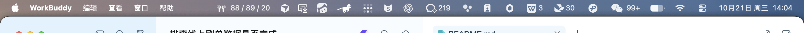
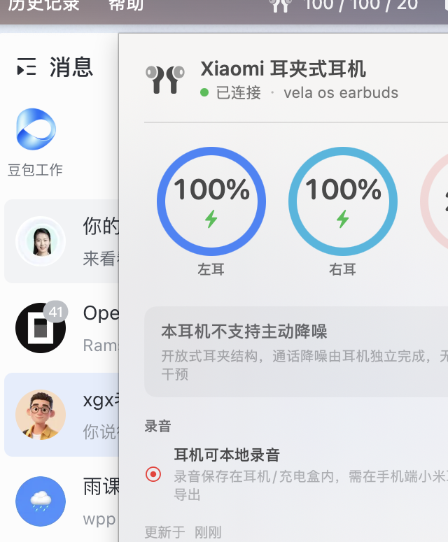
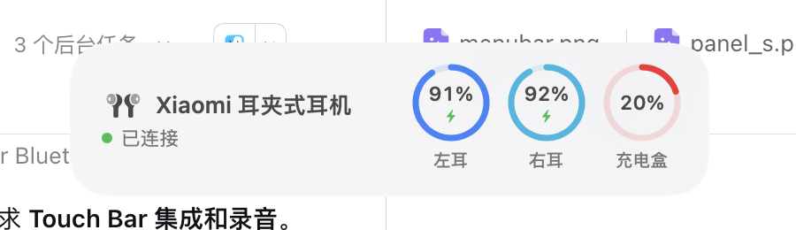

# MiPods

**让小米耳机在 macOS 上「像 AirPods 一样」** —— 菜单栏常驻电量、连接弹出 AirPods 式 HUD、
Touch Bar 控制，全部通过逆向出的 BLE 协议实现，不依赖任何小米 SDK 或官方 App。

[](LICENSE)
[]()
[]()

> 官方「小米互联服务」Mac 版里**完全没有耳机相关代码**（已全量二进制扫描确认），
> 所以这确实是在补一个空白。测试机型：**Xiaomi 耳夹式耳机（M2529E1）**。

---

## 截图

| 菜单栏 | 面板 |
|---|---|
|  |  |



---

###### 兼容性

已在 **Xiaomi 耳夹式耳机（M2529E1）** 上完整验证。协议层（`MiPodsCore`）对小米/Redmi 系
耳机做了能力探测，但**其他型号未实测** —— 欢迎提 issue 附上你的 `GET_DEVICE_INFO` 输出。

## 现在能做什么

| 能力 | 状态 | 说明 |
|---|---|---|
| 左右耳 + 充电盒电量 | ✅ 真机验证 | 免配对、免认证，连接后直接读取 |
| 充电中指示 | ✅ 真机验证 | 电量字节 bit7 |
| 菜单栏常驻显示 | ✅ 真机验证 | 显示 `左 / 右 / 盒`，低电变红 |
| AirPods 式连接弹窗 | ✅ 真机验证 | 顶部居中、不抢焦点、盖住全屏 App |
| 点开面板看详情 | ✅ 真机验证 | 三色电量环 + 设备信息 + 日志 |
| Touch Bar 显示与控制 | ✅ 已验证构建 | 面板打开时出现电量与模式按钮 |
| 降噪/通透切换 | ⚠️ 按型号 | 见下方「关于降噪」 |
| 录音可用状态显示 | ✅ 真机验证 | 佩戴状态推导，见下方「关于录音」 |
| 耳机本地录音导出 | 🔬 协议已还原 | 认证已攻克，卡在设备侧握手后续步骤 |

## 关于降噪：这付耳机没有 ANC

用户这付 **Xiaomi 耳夹式耳机（M2529E1）没有主动降噪**——它是开放式耳夹结构，
包装与拆解都只标「3Mic + VPU AI **通话**降噪」。

所以本项目**不会**画出三个点不动的降噪按钮，而是做**运行时能力探测**：

- 设备上报过非 `off` 的降噪模式 → 认为支持 ANC，显示对应按钮
- 否则显示「本耳机不支持主动降噪」并解释原因

同一套代码对 Redmi Buds 3 Pro / Buds 8 这类真有 ANC 的型号会自动显示
普通 / 降噪 / 通透（/ 抗风噪）四档。

## 关于录音：协议已还原，卡在设备侧会话状态

这付耳机**自带录音与存储**（充电盒有独立蓝牙 SoC + 麦克风 + 录音按键，可离线录音）。
为了挖它，我从 Aptoide 取了**手机端官方 App「小米耳机」`com.mi.earphone` 9.0.278**
（MD5 已校验）用 jadx 完整反编译（12,091 个类），拿到了**整套录音文件协议**：

| config code | 作用 |
|---|---|
| `68` | 录音状态（是否在录） |
| `69` | **录音文件列表**（recordId / 文件名 / 时长 / 大小 / 格式） |
| `70` | 录音容量（左 / 右 / 总时长） |
| `75` | 开始 / 停止录音 |
| `52` | **大文件分片下载**（dataSN + CRC32 + 断点续传） |

而且它跑的通道就是本项目已经在用的 `AF00 / AF07(写) / AF08(收)`。

### 已经攻克的两件事

1. **SAFER+ 认证算法完全正确** —— 纯 Swift 实现，与设备返回**多次逐字节 MATCH**
   （四组真机 challenge/response 已进单元测试）。
2. **关键时序坑**：`0x50` 认证挑战**必须作为连上后的第一帧**发送，否则耳机静默忽略。
   但把它放第一帧会有**副作用**：一旦发过 `0x50`，设备就转入不再应答任何主机命令的状态
   （实测 `0x02` 控制组也静默，3/3 会话复现）。
   所以本项目的取舍是：**电量优先**，`GET_DEVICE_INFO` 先发，认证做成显式 opt-in
   （`requestAuthentication()`），不在连接时自动触发。这条已加回归测试防止改回去。

### 还差什么

设备本身完全正常（纯 `0x02` 6/6 应答），但**只要发起 `0x50`，此后就不再应答任何
主机命令**（连 `0x02` 控制组也静默）。说明握手没走完 —— App 的完整状态机还有
「设备反过来挑战主机 → `AUTH_STAGE_OK`」等后续步骤，我们尚未补齐。

> **决定性验证 = 在 Android 手机上抓一次官方 App 导出录音的 btsnoop**
> （约 15 分钟，步骤见 [`research/record/findings.md`](research/record/findings.md) §12）。
> 这是 macOS 侧无法自行突破的硬边界。

失败过的判断（已撤回）：~~「官方协议里没有文件传输」~~（在私有 config 层有）、
~~「认证需要闭源 native 库」~~（纯 Swift 已 MATCH）、
~~「充电盒不暴露 GATT 所以够不着」~~（走耳机自己通道即可）。

## 协议摘要（真机实测）

传输是 **BLE GATT**，不是经典蓝牙串口。这点很关键：不用配对、不影响 A2DP 音质。

```
服务 0xAF00
  AF07  write            ← 发帧
  AF08  notify           ← 收帧
另外： 180A 设备信息 / 180F×2 标准电量 / FD2D / 01000100-...

帧： FE DC BA | type | opcode | len(2,BE) | [status] | seq | payload | EF
     type: 0xC4 手机请求 / 0x04 应答 / 0xC0 耳机请求 / 0xC7 耳机通知
```

关键 opcode：

| opcode | 含义 | 需要认证 |
|---|---|---|
| `0x02` | GET_DEVICE_INFO → 电量 TLV `0x07` = [左,右,盒] | ❌ 不需要 |
| `0x09` | GET_RUN_INFO → 降噪状态等 | ❌ 不需要 |
| `0x08` | SET_ANC `[0x02, 0x04, mode]` | ✅ 需要 |
| `0x0E` | 主动上报（本机型电量在 TLV `0x04`） | — |
| `0xF4` | 配置通知（`0x0C` = 佩戴状态） | — |
| `0x50/0x51` | SAFER+ 挑战应答 | — |

电量字节：`bit7` = 充电中，低 7 位 = 百分比，`0xFF` = 未知。

认证是**蓝牙风味 SAFER+**（128-bit key，8 轮），**没有固定密钥**——challenge 本身就是
密钥，所以完全可以自研。实现见 [`Protocol.swift`](app/MiPods/Sources/MiPodsCore/Protocol.swift)。

## 安装

### 直接下载

去 [Releases](https://github.com/JackWPP/MiPods/releases/latest) 下载 `MiPods-v*.zip`，
解压后把 `MiPods.app` 拖进 `/Applications`。通用二进制（Apple Silicon + Intel），需要 **macOS 14+**。

> **首次打开会被 Gatekeeper 拦**（未公证，个人项目没有 Apple 开发者账号）。
> 右键点 App → 打开，或执行：
> ```bash
> xattr -dr com.apple.quarantine /Applications/MiPods.app
> ```

### 从源码构建

需要 **Xcode**（不能只装 Command Line Tools —— CLT 缺 SwiftUI 宏插件，
`@State` 会直接编译失败）。

```bash
git clone https://github.com/JackWPP/MiPods.git
cd MiPods/app/MiPods
make app     # 构建 + 打包成 .app
make run     # 启动
make test    # 跑协议回归测试
```

首次启动会请求蓝牙权限。装好后只住在菜单栏，没有 Dock 图标。

## 构建

```bash
cd app/MiPods

# 注意：必须用 Xcode 工具链。CLT 缺 SwiftUI 宏插件，@State 会编译失败。
DEVELOPER_DIR=/Applications/Xcode.app/Contents/Developer swift build

# 打成 .app（必须！裸可执行文件拿不到蓝牙权限，也不会分配菜单栏图标）
make app
open MiPods.app
```

或直接 `make run`。

运行测试（钉住真机抓包字节，防止协议回归）：

```bash
make test     # 13 个用例，全部对真实硬件抓包
```

可用的 make 目标：`build` / `test` / `app` / `run` / `demo`（自动开面板便于截图）/ `stop` / `clean` / `install`。

## 目录

```
app/MiPods/
  Sources/MiPodsCore/         协议层（与 UI 无关，可复用）
    Protocol.swift            帧编解码 + SAFER+
    Models.swift              电量/降噪/设备信息数据模型
    BLETransport.swift        CoreBluetooth 传输
    MiPodsController.swift    状态机 + 对外 ObservableObject
  Tests/MiPodsCoreTests/      协议回归测试（真机抓包字节 + SAFER 向量）
  Sources/MiPodsMenuBar/      UI 层
    MiPodsApp.swift           NSStatusItem 入口
    HUDController.swift       AirPods 式弹窗
    PanelView.swift           主面板
    BatteryRing.swift         三色电量环
    TouchBarController.swift  Touch Bar
  Makefile                    构建 / 打包 / 测试
docs/                         截图
research/                     逆向与验证记录（含真机截图）
tools/bleprobe/               协议探针（开发期工具）
```

## 验证记录

- [`research/web/findings.md`](research/web/findings.md) — 官方协议文档 + 开源实现交叉验证
- [`research/rea/findings.md`](research/rea/findings.md) — 官方 App 逆向 + macOS 窗口/触控栏实测
- [`research/record/findings.md`](research/record/findings.md) — 本地录音通道挖掘

## 已知限制

1. **Touch Bar 无法常驻**。第三方拿不到 Control Strip：`com.apple.private.controlstrip`
   是私有 entitlement，公开 API 无任何入口（已三条独立证据确认）。所以只在面板
   打开时挂到窗口上。
2. **充电盒电量只能走私有协议**，标准蓝牙电量服务只暴露左右耳。
3. 需要 **macOS 14+**，需授予蓝牙权限。

---

## 致谢与许可

本项目以 **AGPL-3.0** 发布，见 [LICENSE](LICENSE)。

协议理解得益于以下开源工作（仅作参考，未复制其代码）：

- [Gadgetbridge](https://codeberg.org/Freeyourgadget/Gadgetbridge)（GPL-3.0）— 小米/Redmi 耳机协议字段的早期参考
- [ChristianVeneko/redmi-buds-bar](https://github.com/ChristianVeneko/redmi-buds-bar)（AGPL-3.0）— macOS 端的帧编解码与 SAFER+ 起步参考
- [MasimbaTakudzwa/galaxy-buds-menubar](https://github.com/MasimbaTakudzwa/galaxy-buds-menubar)（GPL-3.0）— AirPods 式 HUD 的 NSPanel 思路

`SAFER.response(to:)` 已按 SAFER+ 标准参数重写，并用真机 challenge/response 对验证。

> **商标声明**：Xiaomi、Redmi、小米 是其各自所有者的商标。本项目与小米公司无任何关联，
> 为非官方第三方工具。
